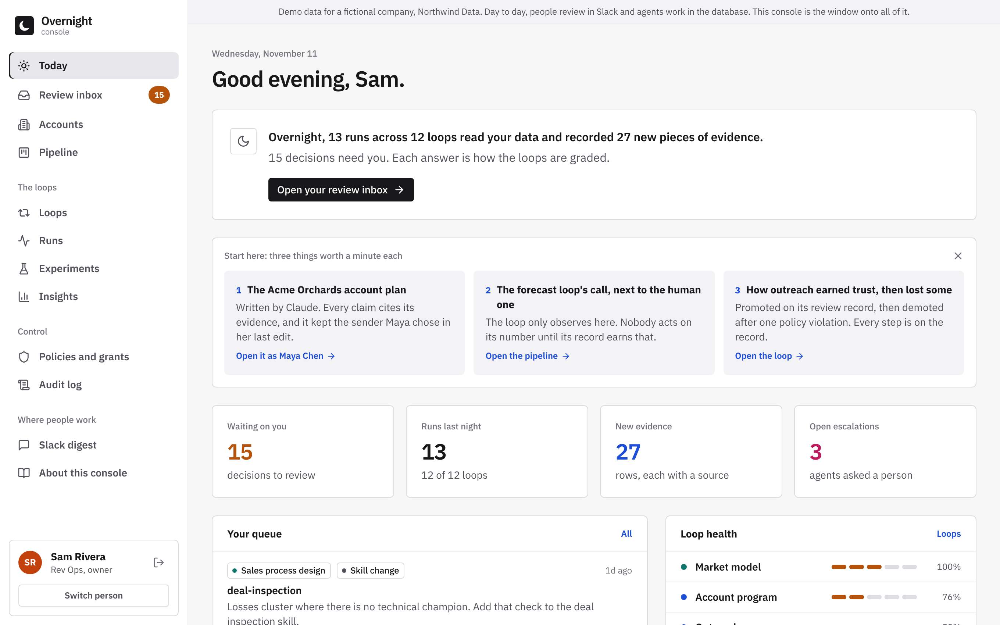
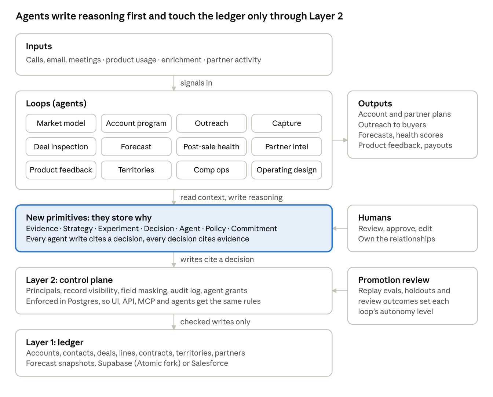

# Overnight

**The open-source AI operating layer for go to market.** Frontier models work every loop of your GTM system every night, writing down why they decided what they did, and earning the right to do more.

**Live demo:** [overnight-gtm.vercel.app](https://overnight-gtm.vercel.app). Pick one of six people at a fictional company and see the same system through their access. No account or password needed.



Most companies use AI as a feature: draft the email, summarize the call, update the CRM. Overnight is for putting AI at the center of how go to market makes decisions, safely. Every Rev Ops function becomes a loop that reads all of the data on a schedule and proposes what to do next. People review the work, and each loop climbs a ladder of **earned autonomy** only as fast as its record allows.

Most AI sales tools bolt a feature onto a CRM built for people typing into forms. This repo starts from a different question. If a capable model sits at the center of go-to-market, reading every account, conversation and partner signal and doing as much of the work as it reliably can, what does the system underneath need to look like?

The answer here is concrete and runs as code:

1. **A ledger (Layer 1)** for the facts that forecasts, comp and board numbers come from: accounts, contacts, deals, lines, contracts, territories, partners, weekly forecast snapshots.
2. **A control plane (Layer 2)** enforced inside Postgres. Visibility follows ownership, management chain and territory. Agents have their own identities, scoped grants, and no direct write access to the ledger. Changes to ledger and governance tables are audited.
3. **New primitives** that store *why*, not just *what*: evidence, strategies, experiments, decisions, policies, commitments, plus runs and skills that record how each agent worked.
4. **Twelve loops**, from account planning and conversation capture to territory design and comp ops, each starting at a low autonomy level.
5. **A promotion review.** A loop moves up a level only when its record clears a bar: reviewed decisions, replay evals, holdout experiments, and zero policy violations. A new model release becomes a promotion review, not a rewrite.



## What has been measured

Built on [Atomic CRM](https://github.com/marmelab/atomic-crm) (MIT, Supabase), whose real schema is vendored at a pinned commit. The same 15 attacks were run against stock Atomic and against Atomic plus these migrations ([full report](docs/attack-report.md)):

| | Stock Atomic | With Overnight |
| --- | --- | --- |
| Attacks allowed (a rep reading, editing or deleting another territory's records, a read-only user editing, an agent writing directly) | 14 of 15 | 0 of 15 |
| `tools/rls-audit` findings, high | 33 | 0 |
| `tools/rls-audit` findings, medium (after review) | 29 | 0 |

Stock Atomic is a good template that is honest about its scope: a small team where everyone may see and change everything. The report shows what changes when that stops being true, and when AI agents connect as users.

The whole stack also installs on a hosted Supabase project and the suite passes against it. The first hosted run found a real gap the local tests had missed, now fixed ([write-up](docs/supabase-hosted-check.md)).

Before publishing, an independent adversarial review tried to break the hardened schema and found real holes, including two ways an agent could change records outside its scope. All confirmed findings are fixed and each has a regression test. The [review write-up](docs/review-2026-11-01.md) lists what was found, what changed, and what is still open.

The test suite (104 tests) also covers the agent contract: agents cannot act outside their scope, cite evidence they cannot see, state weak evidence as fact in a plan, change a field without a decision citing strong evidence, touch a do-not-contact person or a partner-owned account, raise their own autonomy, or act on accounts held out of an experiment. See [STATUS.md](STATUS.md) for exactly what is tested and what is design only.

## Three ways to use it

| Mode | For | The ledger lives in |
| --- | --- | --- |
| Greenfield | A startup with a GTM engineer and no CRM worth keeping | An Atomic CRM fork on Supabase |
| Salesforce sidecar | Growth and enterprise companies | Salesforce. Supabase holds the primitives and a thin id/owner mirror. Agent changes go back through one integration user with a narrow permission set |
| HubSpot sidecar | SMB and mid-market | HubSpot, the same way |

Not sure which, or whether at all? Run `tools/fit-assessment` (or point your own AI at [EVALUATE.md](EVALUATE.md)). For a small team without a GTM engineer, the honest answer is usually to buy a maintained AI-native CRM and borrow the method.

## Try it

Needs Postgres 16 and Python 3.11+. No Supabase account needed for the tests: a small shim stands in for Supabase's auth layer.

```bash
pip install -r requirements.txt
export EA_TEST_DSN="postgresql://postgres@localhost:5432/postgres"   # a Postgres you can create databases on (EA is earned autonomy)
make test           # builds fresh databases and runs all tests
make report         # regenerates docs/attack-report.md and the rls-audit reports
make demo           # a seeded demo database named ea_dev (fictional company "Northwind Data")
```

`EA_TEST_DSN` keeps its `EA_` prefix: EA stands for earned autonomy, the trust ladder each loop climbs.

Run a loop with a live model (any Anthropic model id). `DEMO_DSN` is the database `make demo` builds, `ea_dev`, on the same server as `EA_TEST_DSN`:

```bash
export ANTHROPIC_API_KEY=...
export DEMO_DSN="postgresql://postgres@localhost:5432/ea_dev"
python agents/runtime/runner.py --loop account_program --input '{"company_id": 1}' \
  --dsn "$DEMO_DSN" --agent-uid 00000000-0000-0000-0000-000000000102 --model <model-id>
```

Audit your own Supabase project (read-only by default):

```bash
python tools/rls-audit/rls_audit.py --dsn "$SUPABASE_DB_URL"
```

Deploying on a real Supabase project: [docs/deploying.md](docs/deploying.md).

## Where people work

Nobody has to use a new app. Reps review in a **Slack message** each morning, with one-tap Accept and Reject (`integrations/slack/`). Agents work through **database functions**. Analysts query the primitives with **SQL**.

The **console** (`console/`) is the window onto all of it: the review inbox, every account's why timeline, the loops and how far each one is trusted, prompt versions waiting for approval, experiments, insights, policies and the audit log. It holds no rules. Every button calls a database function that checks permissions itself, and row-level security decides what each person sees.

```bash
cd console && npm install && npm run dev        # points at the public demo database by default
```

The public demo at [overnight-gtm.vercel.app](https://overnight-gtm.vercel.app) is a fictional company, Northwind Data, with two months of generated history and one real Claude run. Pick one of six people and see the same system through their access. No account or password needed. It is wiped and rebuilt every night, so the history always ends last night. A demo link can open a page as one of the six, for example [the Acme Orchards account plan as Maya](https://overnight-gtm.vercel.app/reviews?as=maya&for=Acme%20Orchards).

## Build it: Supabase plus Claude

Everything needed to stand up the whole model is here. Swap in any Postgres for Supabase and any capable model for Claude.

1. **The data model.** Ten migrations in `db/migrations/` create the ledger, control plane and every primitive as Postgres tables, functions and policies. Apply them to an Atomic CRM fork on Supabase, or beside Salesforce or HubSpot.
2. **The loops.** Twelve loop definitions in `agents/loops/`, each a plain-English `prompt.md` that names no tools or tables, plus a `loop.yaml` with its tools, starting and maximum autonomy level, promotion metric, and the technical notes an engineer maintains. A Rev Ops lead can edit the prompts like any document. Fifteen methodology skills in `agents/skills/` (evidence rules, account plans, MEDDPICC, territories, comp credit, forecasting and more), also plain text.
3. **The runner.** `agents/runtime/runner.py` runs a loop with a live model against the database, writing every tool call to `run_events`.
4. **Your own data.** `examples/queries/` has starter SQL for asking the primitives directly: which evidence shows up in accepted plans, where reps override the agents, whether a play beat its holdout, how each model performed.
5. **Better models.** When a new model ships, rerun `evals/replay.py` on it. The prompts, primitives and history stay the same, and loops that score better move up through the promotion review.

Step-by-step deployment: [docs/deploying.md](docs/deploying.md). Pointing an AI at the repo to judge fit: [EVALUATE.md](EVALUATE.md).

## What is in the repo

| Path | What |
| --- | --- |
| `db/migrations/` | Ten migrations: ledger, control plane, primitives, runtime, agent contract, promotion, sidecar, final grants, console (versioned prompts, review queue, insight views, Slack path), forecast calls view |
| `agents/loops/` | Twelve loop definitions with prompts, tools, starting and maximum levels, promotion metrics |
| `agents/skills/` | Versioned methodology the agents load: evidence rules, MEDDPICC, stages, account plans, territories, comp credit, partners, health, forecasting |
| `agents/runtime/` | The runner (live model or scripted), tool definitions, transports for direct Postgres and Supabase REST |
| `console/` | The console: a window onto the whole system. Vite, React and supabase-js, with no rules of its own |
| `integrations/slack/` | The morning digest and the Accept/Reject button handler |
| `agents/hooks/` | A Claude Code capture hook that records each tool call to `run_events` |
| `evals/` | Offline replay harness, deterministic scorers, starter eval sets (synthetic, labeled as such) |
| `tools/rls-audit/` | Standalone row-level security checker for any Supabase project |
| `tools/fit-assessment/` | Should you use this, and in which mode |
| `sidecars/` | Salesforce and HubSpot ingest and writeback, plus Salesforce metadata (custom fields, permission set) |
| `examples/` | Scripted runs, starter SQL for asking the primitives directly (`queries/`), and partner intelligence on a public snapshot of Supabase's integration listings |
| `docs/` | Design, attack report, audit reports, deployment |
| `vendor/atomic-crm/` | Atomic CRM's schema at a pinned commit, MIT licensed |

## Credits

- [Atomic CRM](https://github.com/marmelab/atomic-crm) by Marmelab is the base. Its schema is vendored unchanged under its MIT license.
- Several agent-governance ideas come from [Comp AI CRM](https://github.com/trycompai/crm): evidence strength priced by kind rather than by the model's own confidence, per-agent tool grants, and "the CRM is where the agent keeps its notes."
- Linking an agent session to the change it produced follows the pattern [Entire](https://rywalker.com/research/entire) uses for code.

## License

MIT. See [LICENSE](LICENSE).

Built by Cameron Fagan, with Claude. I have spent ten years building GTM systems (partner operations, territories, forecasting, comp) at Salesforce, HashiCorp and Aviatrix. I wrote this with AI and checked it with tests rather than by reading every line myself, which is also how I think much GTM software will be built from here.
