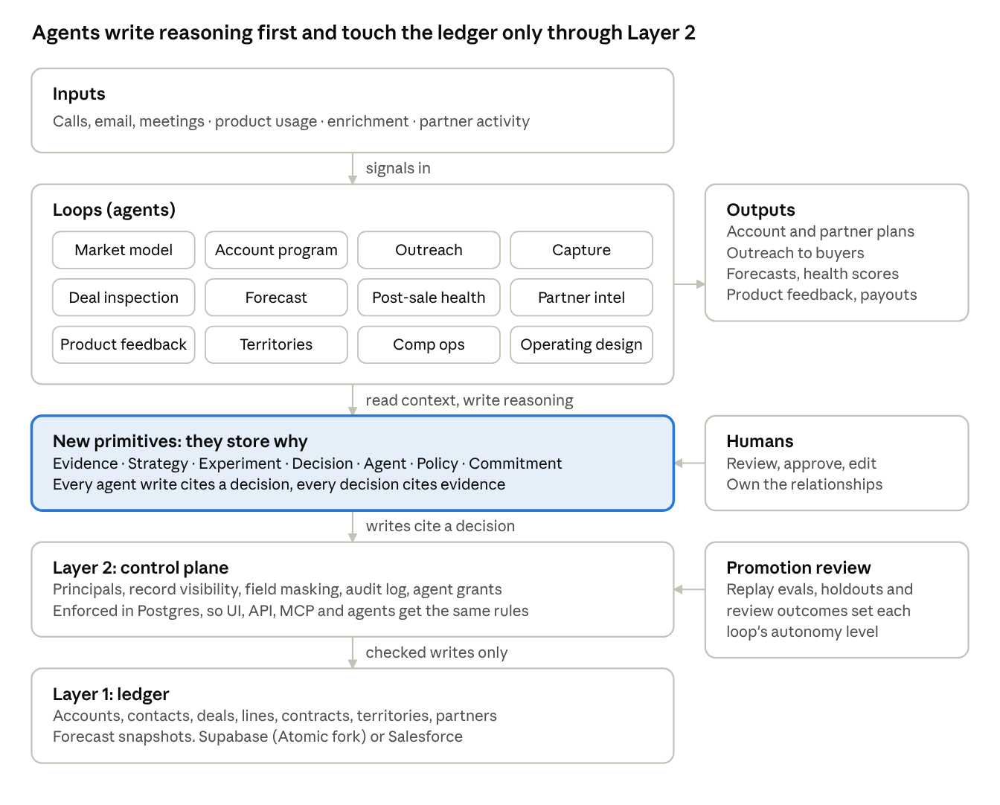

# Design

The ledger and the control plane of a CRM are ordinary Postgres engineering. What is new in an AI-native GTM system is a set of primitives that store reasoning rather than outcomes, and loops that earn autonomy by measured accuracy. This page explains the design and points to the code that implements each part.

Signals come in at the top and loops turn them into reasoning. Reasoning reaches the ledger only through the control plane. Humans review decisions, and the promotion review sets how much each loop may do on its own.

## Layer 1: the ledger

`db/migrations/0001_ledger.sql`

The facts forecasts, comp and board numbers are computed from. Atomic CRM provides companies, contacts, deals, notes, tasks and the seller directory (`sales`). This layer adds what a company past founder-led sales needs.

| Table | Why |
| --- | --- |
| `territories`, `territory_rules`, `territory_members` | The carve, the rules that assign accounts, who works each territory. Effective dates, because a carve changes every year and old credit stays with the old carve |
| `deal_contacts` | Buying-group roles per deal (champion, economic buyer, procurement) |
| `products`, `deal_lines` | What is sold and ARR per line. Discount is masked (Layer 2) |
| `contracts` | Start and end dates, the renewal anchor |
| `partners`, `deal_partners` | Sourced, influenced, resold and fulfilled credit. Margin is masked |
| `forecast_snapshots` | Append-only weekly copy of the pipeline, so forecast accuracy can be measured after the fact |

## Layer 2: the control plane

`db/migrations/0002_control_plane.sql`

Stock Atomic gives every signed-in user `using (true)` on every table. Layer 2 replaces that with five mechanisms, all inside Postgres, so the UI, REST API, MCP and agents get the same rules.

1. **Principals.** Humans and agents each have their own identity and role (owner, manager, rep, read-only, agent). Agents never act as the person who launched them. Atomic's administrator flag still maps to owner, so an existing install keeps working.
2. **Visibility.** `ea_private.can_see(owner, territory)` decides every read. Owners and read-only users see everything; managers see their reporting chain; reps see their own records and their territory; agents see what their grant scope covers.
3. **Field masking.** Discount and partner margin are not selectable by API roles. Owners, managers and partner managers read them through checked functions.
4. **Audit.** A trigger logs every ledger change with the principal, whether it was a human or an agent, and the decision and run behind an agent change. A session variable alone cannot forge that attribution.
5. **Agent grants.** Each agent has a named list of tools and a scope. Ledger write policies require a human, so agents cannot write tables directly at all.

## The new primitives

`db/migrations/0003_primitives.sql`, `0004_runtime.sql`

A human CRM stores state. These tables store why the state is what it is.

| Primitive | One row is | What makes it trustworthy |
| --- | --- | --- |
| Evidence | One sourced observation | Strength comes from its kind (`evidence_kinds`), never the model. Append-only, even for superusers |
| Strategy | A versioned plan for an account, partner or territory | New version per change. Held-out accounts get plans that can never be activated |
| Experiment | A play against a fixed holdout | Assignment is deterministic and frozen when the experiment starts |
| Decision | A choice by an agent, citing evidence | Must cite visible, current evidence. Human review outcome (accepted, edited, rejected) is recorded |
| Policy | A rule of engagement | Checked by the database before every touch |
| Commitment | Something promised to a customer | Points to the evidence of the promise |
| Run | One agent session | Model, prompt version, skill versions, every tool call. Every decision belongs to a run |
| Skill | A versioned instruction file | Changed only by a reviewed new version |

Subjects are `(subject_type, subject_id text)`, so the same tables work with Atomic ids or Salesforce and HubSpot ids.

## The agent contract

`db/migrations/0005_agent_contract.sql`, `agents/runtime/tools.py`

Agents get functions, not SQL. Each write function checks the run belongs to the caller, the tool is granted, the loop's level allows the action, the subject is in scope, policies allow it, and, for ledger changes, that a decision cites strong evidence.

| Level | Name | Agent may | Human |
| --- | --- | --- | --- |
| 0 | Observe | Read, record evidence | Nothing |
| 1 | Suggest | Propose decisions, strategies, commitments, skill edits | Acts on them or not |
| 2 | Act with approval | Queue field updates and touches | Approves each one |
| 3 | Act and report | Apply allowlisted field updates, schedule touches | Reviews samples |
| 4 | Autonomous within policy | Same, inside policy | Audits |

The effective level is the lower of the level at run start and the level now, so a demotion takes effect mid-run. Money, owners, territories and forecast category are not on the agent field allowlist at any level.

Hooks capture, the database enforces. A capture hook (`agents/hooks/`) records each tool call to `run_events`, but if the hook is removed the database still enforces every rule.

## The loops

`agents/loops/`, `agents/skills/`

Twelve loops, each with a trigger, tools, starting and maximum level, and one promotion metric: market model, account program, outreach, conversation capture, deal inspection, forecast, post-sale health, partner intelligence, product feedback, territory and capacity, comp ops, and operating design. Comp ops, territory and operating design never pass level 2, because pay and process need a human signature. Forecast starts at level 0 and records an independent call beside the human one.

## Learning without fooling ourselves

`db/migrations/0006_promotion.sql`

Deals close for reasons a loop did not cause. A loop that learns from wins alone copies noise. So customer-facing loops are measured against a holdout fixed before outcomes are known.

Worked example: 400 accounts, 80 held out. After 60 days, 48 of 320 treated accounts booked a meeting (15%) and 8 of 80 held out did (10%). The gap is 5 points, but the 95% range runs from about 3 points worse to 13 points better, so the test cannot tell yet. Detecting a real 5-point lift needs about 680 accounts per arm. `public.experiment_result()` computes this, and a test checks it against these numbers.

## Promotion review

`public.promotion_check()`, `public.decide_promotion()`

A loop moves up one level when the record clears the bar in `promotion_rules`: enough reviewed decisions, a high enough accepted-as-is rate, a low enough rejection rate, a replay score at least as good as the current version, and no policy violations in 60 days. Level 4 also needs a sampled audit showing the agent's error rate below the human error rate on the same work. There is no override for moving up. Moving down is always allowed, and one confirmed violation demotes immediately.

When a new model ships, every loop's replay set runs on it (`evals/replay.py`). Loops that score better switch. Loops that now clear the next bar get a trial at the higher level with full review. A model upgrade becomes a promotion review, not a rewrite.

## Human roles

| Role | Does | Shows up as |
| --- | --- | --- |
| Rep | The relationship work. Reviews and corrects agent plans. Adds evidence only they have | Review outcomes, evidence, owned deals |
| Sales leader | Where people and agents spend effort. Owns the forecast call | Operating design approvals, policies |
| RevOps | Owns the loops: experiments, evals, promotion reviews | Experiments, replay results, grants |
| Partner manager | Partner relationships and partner plans | Partner strategies, partner credit |
| Finance | Signs payouts and credit rules | Comp ops decisions |
| Security | Principals, grants, the audit log | `principals`, `agent_grants`, `audit_log` |

The biggest change is RevOps: from maintaining the CRM to owning the experiments and evals that decide when a loop has earned more autonomy.

## Sidecar mode

`db/migrations/0007_sidecar.sql`, `sidecars/`

Beside Salesforce or HubSpot, Supabase holds the primitives plus a thin mirror (ids, names, owners, territory keys) so visibility rules work the same way. Agent changes go out through `outbound_changes`, sent by a writeback worker as one integration user. In Salesforce that user holds only the `EA_Agent_Writer` permission set, so Salesforce's own sharing, field-level security and field history still apply, and each write carries `EA_Decision_Id__c`.

## Why build a layer, not a new CRM

The primitives, contract and promotion review are tables and functions. They do not depend on which CRM screens sit on top, which is why the same layer runs on an Atomic fork or beside Salesforce. Atomic was chosen as the greenfield base because it is MIT licensed, built to be forked, and already on Supabase.
